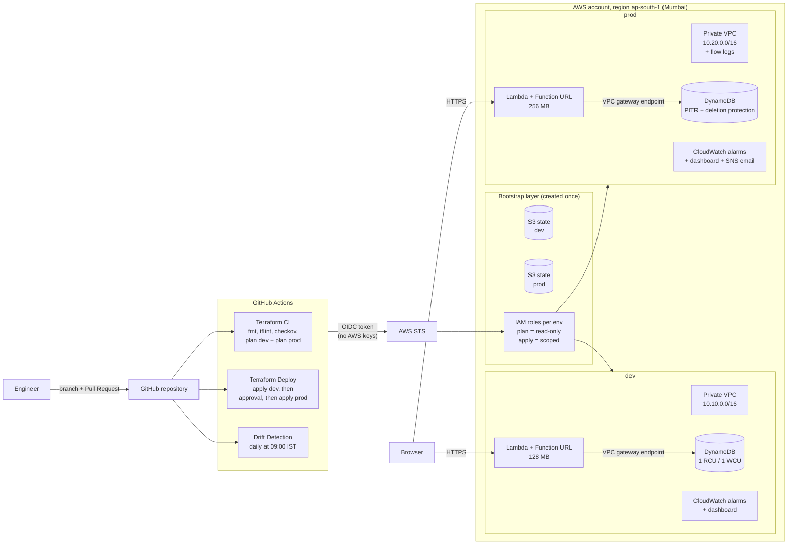
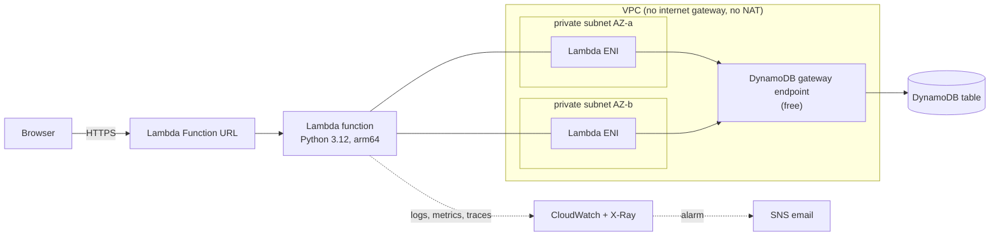
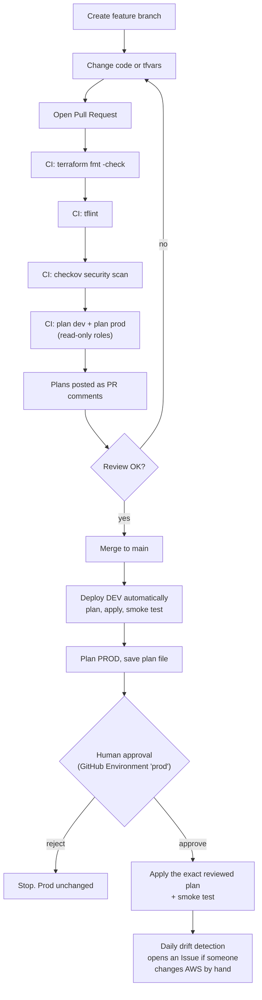
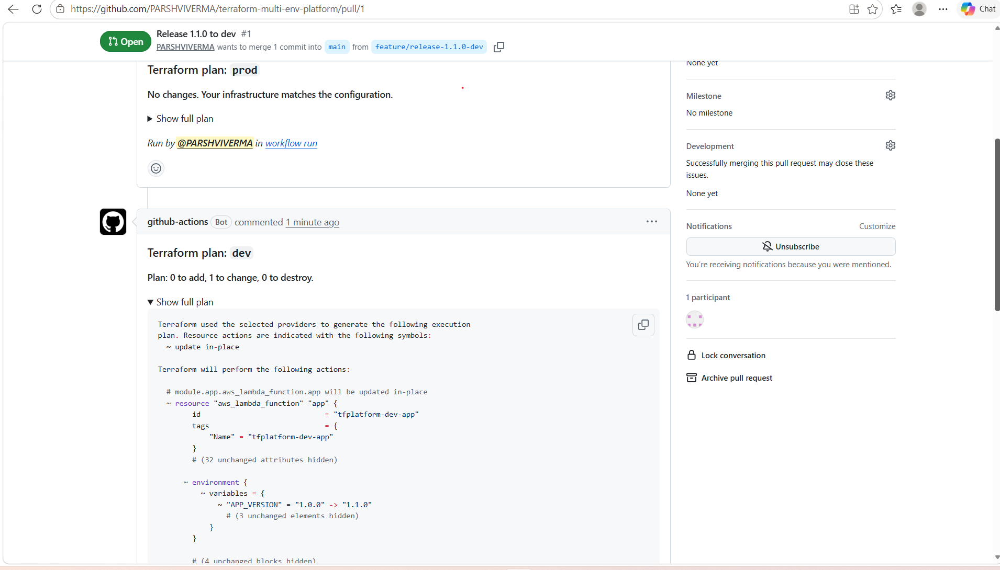
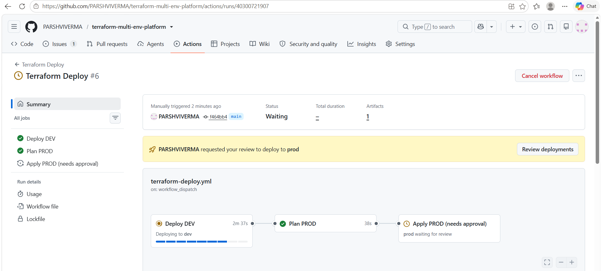
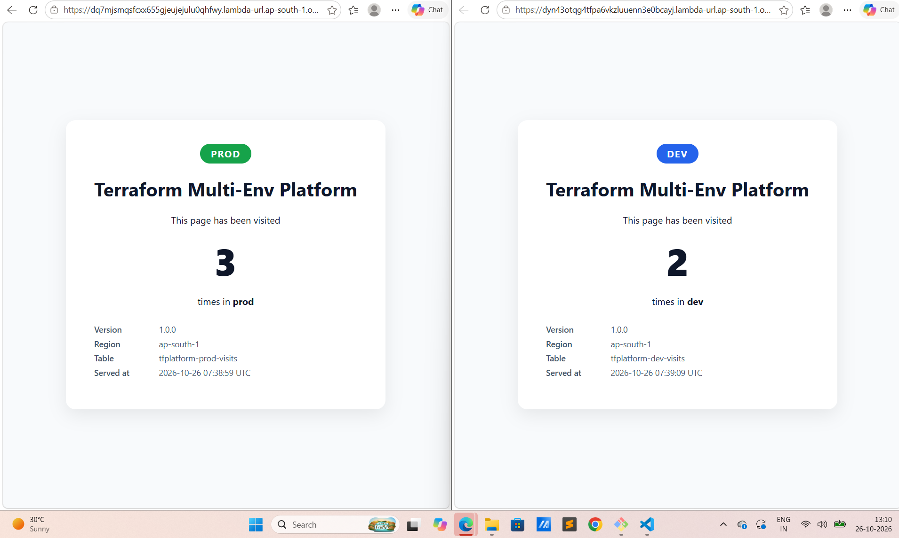
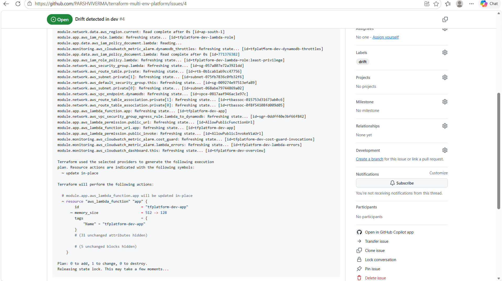

# Terraform Multi-Environment Platform on AWS

**One set of Terraform modules. Two fully isolated environments (dev and prod). Separate remote state. Keyless CI/CD with approval gates, security scanning and daily drift detection. Runs entirely on the AWS Always Free tier: $0/month.**

This project answers a classic platform-engineering question:

> *"You have the same Terraform modules for dev and prod, but each needs its own state. How do you deploy infrastructure the way it's done in industry, keep dev different from prod, follow security best practices, and maintain the infra code end to end?"*

---

## Architecture



### What runs inside each environment



---

## How code reaches production



---

## Same code, different environments

`envs/dev/main.tf` and `envs/prod/main.tf` are **identical files**. Run `diff envs/dev/main.tf envs/prod/main.tf` to check. Only two files differ per environment:

| File | Purpose |
|---|---|
| `backend.tf` | Which S3 bucket holds the state (one bucket per environment) |
| `terraform.tfvars` | Sizes, retention and protection settings |

| Setting | dev | prod |
|---|---|---|
| VPC CIDR | 10.10.0.0/16 | 10.20.0.0/16 |
| VPC flow logs | off | on (rejected traffic) |
| Lambda memory | 128 MB | 256 MB |
| Log level | DEBUG | INFO |
| Log retention | 3 days | 30 days |
| DynamoDB capacity | 1 read / 1 write | 2 read / 2 write |
| Point-in-time recovery | off | on |
| Deletion protection | off | **on, enforced by a validation rule** |
| Deploys | automatically on merge | only after human approval |
| Alerts | optional email | email |

---

## Security controls

| Control | How it is implemented |
|---|---|
| No long-lived AWS keys in CI | GitHub OIDC federation; tokens expire in 1 hour |
| Least privilege per stage | Pull requests use a **read-only** plan role; only merged code can use the apply role |
| Prod needs a human | The prod apply role trusts only the GitHub Environment `prod`, which has required reviewers |
| Apply what was reviewed | The prod plan is saved as an artifact and that exact file is applied after approval |
| State isolation | One S3 bucket per environment, plus an explicit IAM **deny** on the other environment's bucket |
| Pipeline can't escalate privileges | The apply role may only manage IAM roles named `<project>-<env>-*`; its own role is named `gha-*`, so it can't edit itself |
| Cross-environment guardrail | Apply roles are denied on resources tagged with another environment |
| State protection | Versioning, encryption at rest, TLS-only bucket policy, public access blocked, ACLs disabled |
| State locking | S3-native lock file (`use_lockfile = true`), no extra DynamoDB table |
| Network | Private subnets only, no internet gateway, no NAT, default security group locked, egress allowed only to DynamoDB |
| App permissions | The Lambda role can only `GetItem`/`UpdateItem` on its own table and write its own logs |
| Shift-left scanning | `checkov` and `tflint` on every pull request; every skipped check has a written reason next to the code |
| Prod data safety | Deletion protection, point-in-time recovery, and a variable validation that blocks turning protection off in prod |
| Drift | Daily `terraform plan -detailed-exitcode`; drift opens a GitHub Issue |
| Secrets | None exist. Access is through IAM roles; no passwords in code, tfvars, or state |

---

## Cost: $0 per month

Everything uses AWS **Always Free** allowances, which don't expire and apply to every account:

| Service | Always Free allowance | This project uses |
|---|---|---|
| Lambda | 1M requests + 400,000 GB-seconds per month | A few hundred requests |
| DynamoDB | 25 GB + 25 read and 25 write capacity units | 3 RCU + 3 WCU, a few bytes |
| CloudWatch | 10 alarms, 3 dashboards, 5 GB logs | 6 alarms, 2 dashboards, a few MB |
| SNS | 1,000 email notifications | A handful |
| X-Ray | 100,000 traces per month | A few hundred |
| VPC, subnets, security groups, gateway endpoint | No hourly charge | Yes |
| S3 (state) | Billed per GB; state files are a few KB | Rounds to $0.00 |
| GitHub Actions | Free for public repositories | Yes |

**Deliberately avoided** because they cost money: NAT gateway (~$33/month), load balancer (~$18/month), EC2, RDS, public IPv4 addresses, customer-managed KMS keys ($1/month each), Secrets Manager ($0.40/secret).

A **Cost guard** CloudWatch alarm emails you if the app gets more than 1,000 requests in an hour, and DynamoDB's provisioned capacity means extra traffic is throttled, not billed.

---

## Repository structure

```
.
├── bootstrap/                  # Run ONCE from your laptop
│   ├── main.tf                 # state buckets, OIDC provider, IAM roles
│   ├── variables.tf
│   ├── outputs.tf
│   ├── versions.tf
│   └── terraform.tfvars.example
├── modules/                    # Reusable building blocks (used by BOTH envs)
│   ├── network/                # private VPC, subnets, DynamoDB endpoint, SGs, flow logs
│   ├── dynamodb/               # table with PITR + deletion protection switches
│   ├── lambda_app/             # Lambda, Function URL, IAM role, log group
│   │   └── src/app.py          # the visit-counter app
│   └── monitoring/             # SNS topic, 3 alarms, dashboard
├── envs/
│   ├── dev/                    # main.tf identical to prod
│   │   ├── backend.tf          # -> dev state bucket
│   │   └── terraform.tfvars    # dev settings
│   └── prod/
│       ├── backend.tf          # -> prod state bucket
│       └── terraform.tfvars    # prod settings
├── .github/workflows/
│   ├── terraform-ci.yml        # PR: fmt, tflint, checkov, plan both envs
│   ├── terraform-deploy.yml    # main: dev -> approval -> prod
│   └── drift-detection.yml     # daily drift check
├── .tflint.hcl
├── .checkov.yaml
└── docs/
    ├── STEP-BY-STEP-GUIDE.md   # build it yourself from zero
    └── screenshots/
```

---

## Getting started

Follow **[docs/STEP-BY-STEP-GUIDE.md](docs/STEP-BY-STEP-GUIDE.md)**. It covers prerequisites, bootstrap, CI/CD setup, guardrail tests and teardown.

Short version:

```bash
# 1. one-time bootstrap (from your laptop, admin credentials)
cd bootstrap && cp terraform.tfvars.example terraform.tfvars   # edit values
terraform init && terraform apply

# 2. point envs at their state buckets
sed -i "s/REPLACE_ACCOUNT_ID/<your-account-id>/" envs/*/backend.tf

# 3. set GitHub repo variables AWS_ACCOUNT_ID + AWS_REGION,
#    create Environments "dev" and "prod" (prod: required reviewer), then push
git push origin main
```

---

## Screenshots

| | |
|---|---|
| Pull request with plan comments |  |
| Pipeline waiting for prod approval |  |
| dev and prod apps side by side |  |
| Drift detection issue |  |

---

## What I would add in a larger organisation

- Separate AWS accounts per environment (AWS Organizations + SCPs) instead of tag-based guardrails
- Versioned modules in their own repository or a private registry, with prod pinned to a release tag
- Customer-managed KMS keys for state and logs
- GitHub Actions pinned to commit SHAs, plus Dependabot for actions and providers
- Policy as code (OPA/Conftest) and cost estimation (Infracost) in pull requests
- CloudFront + WAF in front of the app, custom domain with ACM
## Lessons learned

**GitHub OIDC immutable subject claims.** The first deploy failed with `Not authorized to perform sts:AssumeRoleWithWebIdentity`, even though the repo name, trust policy and OIDC audience all matched. CloudTrail's `AssumeRoleWithWebIdentity` event showed the real token subject: `repo:OWNER@OWNER_ID/REPO@REPO_ID:environment:dev`. GitHub was sending the immutable, ID-based format. I updated the bootstrap so the roles trust the ID-based subject (pinned to this repo's numeric IDs) alongside the classic one. That is also more secure, because IDs can't be re-registered the way names can.

**Formatting is a gate too.** Changing `true` to `false` in a tfvars file shifted comment alignment, and `terraform fmt -check` blocked the PR before plan. I now run `terraform fmt -recursive` before every commit.

**Test the guardrails, don't just claim them.** I verified each control: a variable validation blocks disabling prod deletion protection, the IAM Policy Simulator shows an explicit deny for dev on prod state, DynamoDB refuses to delete the prod table, and drift detection opened an issue for a manual console change.
