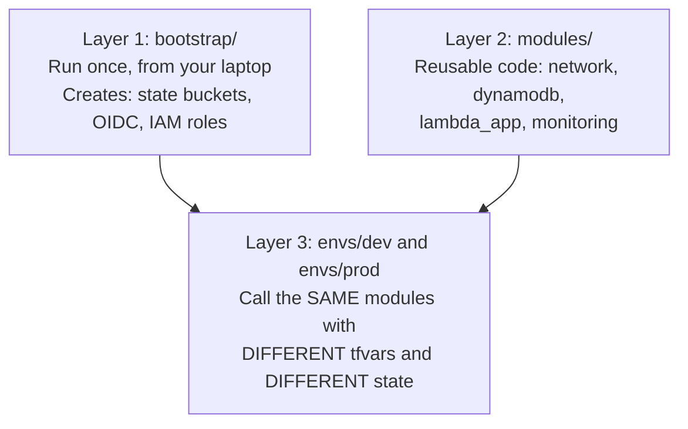
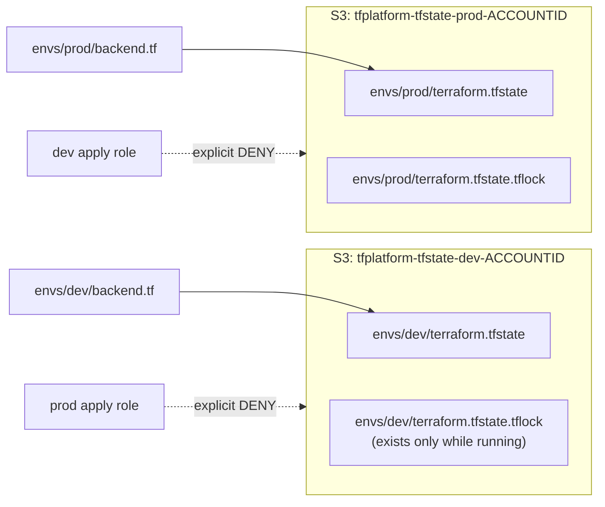
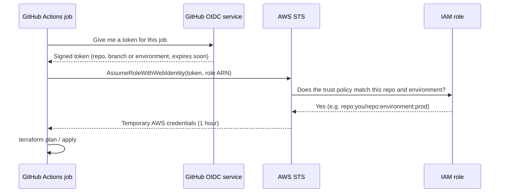

# Step-by-Step Guide: Build This Project From Zero

This guide assumes you are new to Terraform, AWS and GitHub Actions. Follow it top to bottom. Every command is given in full. Wherever you see **📸 Screenshot**, take that screenshot and save it in `docs/screenshots/` with the exact file name shown. The README already links to those names.

**Time needed:** about 3 to 4 hours the first time.
**Cost:** $0. Every service used is in the AWS Always Free tier. Step 1.3 sets up alerts so you'll know immediately if anything ever costs money.

---

## Table of contents

- [Part 0: Understand what you are building](#part-0-understand-what-you-are-building)
- [Part 1: Create and secure your AWS account](#part-1-create-and-secure-your-aws-account)
- [Part 2: Install the tools on your laptop](#part-2-install-the-tools-on-your-laptop)
- [Part 3: Create the GitHub repository](#part-3-create-the-github-repository)
- [Part 4: Connect your laptop to AWS](#part-4-connect-your-laptop-to-aws)
- [Part 5: Run the bootstrap (state buckets and IAM roles)](#part-5-run-the-bootstrap)
- [Part 6: Point dev and prod at their state buckets](#part-6-point-dev-and-prod-at-their-state-buckets)
- [Part 7: Run the checks locally](#part-7-run-the-checks-locally)
- [Part 8: Configure GitHub (variables, environments)](#part-8-configure-github)
- [Part 9: First deployment: push and approve](#part-9-first-deployment)
- [Part 10: Explore what you built in the AWS console](#part-10-explore-what-you-built)
- [Part 11: Make a change the industry way (Pull Request)](#part-11-make-a-change-with-a-pull-request)
- [Part 12: Prove the guardrails work](#part-12-prove-the-guardrails-work)
- [Part 13: Drift detection demo](#part-13-drift-detection-demo)
- [Part 14: Protect the main branch](#part-14-protect-the-main-branch)
- [Part 15: Keep it running or destroy it](#part-15-keep-it-running-or-destroy-it)
- [Screenshot checklist](#screenshot-checklist)
- [Troubleshooting](#troubleshooting)

---

## Part 0: Understand what you are building

Read this once. These are the words the interviewer will use.

| Term | Plain-English meaning |
|---|---|
| **Terraform** | A tool where you describe infrastructure in code (`.tf` files) and it creates it in AWS for you. |
| **Provider** | The plugin that lets Terraform talk to AWS (`hashicorp/aws`). |
| **Resource** | One thing in AWS, e.g. one Lambda function or one S3 bucket. |
| **Module** | A reusable folder of Terraform code, like a function in programming. You write it once and call it from dev and from prod with different inputs. |
| **Root module** | The folder you run `terraform` commands in. Here: `bootstrap/`, `envs/dev/`, `envs/prod/`. |
| **Variables / tfvars** | Inputs. `variables.tf` declares them; `terraform.tfvars` gives the values. |
| **State** | A JSON file where Terraform remembers what it created. If you lose it, Terraform forgets your infrastructure. |
| **Backend** | Where the state is stored. We use S3 (remote), not your laptop (local). |
| **State lock** | A small lock file that stops two people running Terraform on the same state at the same time. |
| **plan / apply** | `plan` shows what would change. `apply` makes the change. |
| **Drift** | When real AWS no longer matches the code, usually because someone clicked in the console. |
| **OIDC** | A way for GitHub Actions to log in to AWS with a short-lived token instead of stored access keys. |
| **GitHub Environment** | A named target (dev, prod) in GitHub. You can require a human approval before a job using it runs. |

### The three layers



### Where each environment's state lives



### How GitHub logs in to AWS without keys (OIDC)



---

## Part 1: Create and secure your AWS account

### 1.1 Create the account

1. Go to <https://aws.amazon.com> and click **Create an AWS Account**.
2. Enter your email, an account name (e.g. `parshvi-terraform-lab`), and verify the email.
3. Choose a plan. AWS now offers a **Free plan** (credits, up to 6 months) and a **Paid plan**. Both include the **Always Free** services this project uses. If you pick the Free plan, note that AWS closes Free-plan accounts after 6 months unless you upgrade; upgrading does **not** start charging you for Always Free usage.
4. Add a card (required for verification; Indian cards usually get a ₹2 verification charge that's refunded).
5. Choose **Basic support (free)**.

### 1.2 Protect the root user with MFA

The root user can do anything, including close the account. Protect it.

1. Sign in as root.
2. Top-right, click your account name, then **Security credentials**.
3. Under **Multi-factor authentication (MFA)**, click **Assign MFA device**.
4. Choose **Authenticator app**, scan the QR code with Google Authenticator or Microsoft Authenticator, and enter two codes.

### 1.3 Set up billing alerts (do this before anything else)

1. Search for **Billing and Cost Management** in the top search bar and open it.
2. Left menu: **Budgets**, then **Create budget**.
3. Choose **Use a template (simplified)**, then **Zero spend budget**.
4. Budget name: `zero-spend`. Email: your email. Click **Create budget**.
   This emails you as soon as anything costs even $0.01.
5. Create a second one: **Monthly cost budget**, amount `1` (USD), same email. This is a backup alert.
6. Left menu: **Billing preferences**. Turn on **Receive AWS Free Tier alerts** and enter your email. Save.

> **📸 Screenshot 01**: `01-aws-budget-alerts.png`. The **Budgets** page showing both budgets.

### 1.4 Create an admin user for your laptop

Never use root for daily work. Create an IAM user for the one-time bootstrap.

1. Search **IAM**, open it.
2. Left menu: **Users**, then **Create user**.
3. User name: `terraform-admin`. Do **not** tick console access. Click **Next**.
4. **Attach policies directly**, tick **AdministratorAccess**, **Next**, **Create user**.
5. Click the new user, open the **Security credentials** tab.
6. **Assign MFA device** (same as before).
7. **Create access key**, choose **Command Line Interface (CLI)**, tick the confirmation, **Next**, **Create access key**.
8. **Download the .csv file** and keep it safe. You'll never see the secret again.

> 🔐 These keys are only used on your laptop for the bootstrap and for cleanup. GitHub never gets them. In Part 15 you'll deactivate them.

### 1.5 Pick the region

Top-right of the console, choose **Asia Pacific (Mumbai) ap-south-1**. All code uses this region.

---

## Part 2: Install the tools on your laptop

| Tool | Why you need it | Minimum version |
|---|---|---|
| Git | Version control, push to GitHub | any recent |
| VS Code | Code editor | any recent |
| AWS CLI v2 | Talk to AWS from the terminal | 2.x |
| Terraform | Create the infrastructure | **1.10 or newer** (1.12.2 recommended, same as CI) |
| TFLint | Lint Terraform code | any recent |
| Python 3 + pip | Needed to install Checkov | 3.9+ |
| Checkov | Security scanner for Terraform | any recent |

### Windows

**Use Git Bash for every command in this guide.** It understands the same commands as Mac and Linux. After installing Git, open the Start menu and search "Git Bash".

Open **PowerShell as Administrator** once, and run:

```powershell
winget install --id Git.Git -e
winget install --id Microsoft.VisualStudioCode -e
winget install --id Amazon.AWSCLI -e
winget install --id Hashicorp.Terraform -e --version 1.12.2
winget install --id Python.Python.3.12 -e
```

If `--version 1.12.2` isn't available in winget, install without it and note the version you got. See the note on [Terraform version](#terraform-version-must-match-ci) below.

**TFLint on Windows**: install Chocolatey from <https://chocolatey.org/install>, then in an Administrator PowerShell:

```powershell
choco install tflint -y
```

Close and reopen Git Bash, then install Checkov:

```bash
pip install checkov
```

### macOS

```bash
# Install Homebrew first if you don't have it: https://brew.sh
brew install git awscli tflint python
brew install --cask visual-studio-code
brew install tfenv            # lets you install an exact Terraform version
tfenv install 1.12.2
tfenv use 1.12.2
pip3 install checkov
```

### Ubuntu / Linux / WSL

```bash
sudo apt update && sudo apt install -y git unzip curl python3-pip

# AWS CLI v2
curl "https://awscli.amazonaws.com/awscli-exe-linux-x86_64.zip" -o awscliv2.zip
unzip awscliv2.zip && sudo ./aws/install

# Terraform 1.12.2 (exact version)
curl -LO https://releases.hashicorp.com/terraform/1.12.2/terraform_1.12.2_linux_amd64.zip
unzip terraform_1.12.2_linux_amd64.zip && sudo mv terraform /usr/local/bin/

# TFLint
curl -s https://raw.githubusercontent.com/terraform-linters/tflint/master/install_linux.sh | bash

# Checkov
pip3 install checkov
```

### VS Code extensions

Open VS Code, press `Ctrl+Shift+X` and install:
- **HashiCorp Terraform** (syntax highlighting, formatting on save)
- **GitHub Actions** (YAML help for workflows)
- **Markdown Preview Mermaid Support** (to see the diagrams in this guide)

### Verify everything

```bash
git --version
aws --version
terraform version
tflint --version
checkov --version
```

> **📸 Screenshot 02**: `02-tool-versions.png`. Your terminal showing all five versions.

### Terraform version must match CI

The pipelines install Terraform **1.12.2** (`TF_VERSION` at the top of the three files in `.github/workflows/`). If you installed a different version locally (say `1.13.1`), open those three files and change `TF_VERSION: "1.12.2"` to your version. Keeping both the same avoids state-version surprises.

---

## Part 3: Create the GitHub repository

1. Go to <https://github.com/new>.
2. Repository name: `terraform-multi-env-platform`.
3. Visibility: **Public**. This matters: on a free GitHub account, **required reviewers** (the prod approval gate) only work on public repositories. Public repos also get unlimited free Actions minutes.
4. Do **not** add a README, .gitignore or licence (the project already has them).
5. Click **Create repository**. Leave the page open; it shows the repo URL.

On your laptop, set up Git once:

```bash
git config --global user.name "Your Name"
git config --global user.email "you@example.com"
git config --global init.defaultBranch main
```

Unzip the project you received, then in Git Bash:

```bash
cd ~/Downloads/terraform-multi-env-platform     # wherever you unzipped it
git init
git remote add origin https://github.com/<your-username>/terraform-multi-env-platform.git
```

> ⚠️ **Don't push yet.** Pushing to `main` starts a deployment, which would fail until AWS and GitHub are configured (Parts 5 to 8).

Open the folder in VS Code:

```bash
code .
```

---

## Part 4: Connect your laptop to AWS

Create a named profile with the keys from the CSV file (step 1.4):

```bash
aws configure --profile tf-admin
```

Answer the prompts:

```
AWS Access Key ID [None]:      <from the CSV>
AWS Secret Access Key [None]:  <from the CSV>
Default region name [None]:    ap-south-1
Default output format [None]:  json
```

Tell every command in this terminal to use that profile:

```bash
export AWS_PROFILE=tf-admin
```

> You must run `export AWS_PROFILE=tf-admin` again every time you open a new terminal.

Check it works:

```bash
aws sts get-caller-identity
```

Expected output (your numbers differ):

```json
{
    "UserId": "AIDAXXXXXXXXXXXXXXXX",
    "Account": "123456789012",
    "Arn": "arn:aws:iam::123456789012:user/terraform-admin"
}
```

**Write down the 12-digit `Account` number.** You'll use it several times.

---

## Part 5: Run the bootstrap

The bootstrap creates what the pipelines need before they can run. It's the "chicken and egg" step: Terraform needs a bucket to store state, but something has to create that bucket first. So the bootstrap runs **once** from your laptop with local state.

What it creates (all free):
- `tfplatform-tfstate-dev-<ACCOUNT>` and `tfplatform-tfstate-prod-<ACCOUNT>` S3 buckets: versioned, encrypted, public access blocked, HTTPS-only
- The GitHub OIDC identity provider
- 4 IAM roles: `gha-tfplatform-dev-plan`, `gha-tfplatform-dev-apply`, `gha-tfplatform-prod-plan`, `gha-tfplatform-prod-apply`

### 5.1 Fill in your values

```bash
cd bootstrap
cp terraform.tfvars.example terraform.tfvars
```

Open `bootstrap/terraform.tfvars` in VS Code and set:

```hcl
owner        = "parshvi"                       # your name or username
github_owner = "<your-github-username>"        # EXACTLY as in the repo URL
github_repo  = "terraform-multi-env-platform"  # EXACTLY as in the repo URL
```

> ⚠️ `github_owner` and `github_repo` must match your repository **exactly**, including upper/lower case. The IAM roles only trust that one repository. A typo here is the #1 cause of "Not authorized to perform sts:AssumeRoleWithWebIdentity" later.

> `terraform.tfvars` in `bootstrap/` is in `.gitignore`, so your personal values aren't pushed.

### 5.2 Initialise

```bash
terraform init
```

This downloads the AWS provider into a hidden `.terraform/` folder. You should see **"Terraform has been successfully initialized!"**

### 5.3 Plan

```bash
terraform plan
```

Read the output. Lines starting with `+` will be created. The last line should say something like **`Plan: 27 to add, 0 to change, 0 to destroy.`** (the exact number may differ slightly).

### 5.4 Apply

```bash
terraform apply
```

Terraform shows the plan again and asks `Enter a value:`. Type `yes` and press Enter. It takes about 30 seconds.

At the end you'll see the outputs:

```
apply_role_arns = {
  "dev"  = "arn:aws:iam::123456789012:role/gha-tfplatform-dev-apply"
  "prod" = "arn:aws:iam::123456789012:role/gha-tfplatform-prod-apply"
}
aws_account_id = "123456789012"
state_buckets = {
  "dev"  = "tfplatform-tfstate-dev-123456789012"
  "prod" = "tfplatform-tfstate-prod-123456789012"
}
...
```

> **📸 Screenshot 03**: `03-bootstrap-apply-output.png`. The terminal with `Apply complete!` and the outputs.

> **If you get "EntityAlreadyExists" for the OIDC provider**: your account already has one. Add `create_github_oidc_provider = false` to `bootstrap/terraform.tfvars` and run `terraform apply` again.

### 5.5 Look at what was created

1. AWS console, search **S3**. You'll see the two state buckets.
2. Click the **prod** bucket, then the **Properties** tab: scroll to see **Bucket Versioning: Enabled** and **Default encryption: SSE-S3**.
3. **Permissions** tab: **Block all public access: On**, and the bucket policy with `DenyInsecureTransport`.

> **📸 Screenshot 04**: `04-s3-state-buckets.png`. The S3 list showing both buckets (or the Properties tab of one).

4. Open **IAM**, then **Roles**, and type `gha-` in the search box. You'll see the 4 roles.

> **📸 Screenshot 05**: `05-iam-roles-oidc.png`. The 4 `gha-` roles.

5. Click `gha-tfplatform-prod-apply`, open the **Trust relationships** tab. You'll see it only trusts `repo:<you>/terraform-multi-env-platform:environment:prod`. This line is what makes the prod approval impossible to bypass.

> **📸 Screenshot 06**: `06-prod-apply-role-trust-policy.png`. That trust policy.

### 5.6 (Optional, recommended) Move the bootstrap state into S3

Right now the bootstrap state is a file on your laptop (`bootstrap/terraform.tfstate`). If your laptop dies, Terraform forgets these resources. To move it to S3:

1. Open `bootstrap/versions.tf` and uncomment the `backend "s3"` block (remove the `#` at the start of those lines).
2. Replace `<YOUR_ACCOUNT_ID>` with your account number.
3. Run:

```bash
terraform init -migrate-state
```

Type `yes` when asked to copy the state. Then delete the local copy:

```bash
rm terraform.tfstate terraform.tfstate.backup
```

Go back to the project root:

```bash
cd ..
```

---

## Part 6: Point dev and prod at their state buckets

Each environment's `backend.tf` contains the placeholder `REPLACE_ACCOUNT_ID`. Replace it with your account number (example uses `123456789012`):

```bash
ACCOUNT_ID=$(aws sts get-caller-identity --query Account --output text)
echo $ACCOUNT_ID
sed -i "s/REPLACE_ACCOUNT_ID/$ACCOUNT_ID/" envs/dev/backend.tf envs/prod/backend.tf
grep bucket envs/*/backend.tf
```

> On macOS use `sed -i '' "s/REPLACE_ACCOUNT_ID/$ACCOUNT_ID/" envs/dev/backend.tf envs/prod/backend.tf`

You should see:

```
envs/dev/backend.tf:    bucket       = "tfplatform-tfstate-dev-123456789012"
envs/prod/backend.tf:   bucket       = "tfplatform-tfstate-prod-123456789012"
```

Now set your name in both tfvars files. Open `envs/dev/terraform.tfvars` and `envs/prod/terraform.tfvars` and change:

```hcl
owner = "your-github-username"   # <-- your name
```

Optionally put your email in `envs/prod/terraform.tfvars` to receive prod alarm emails:

```hcl
alert_email = "you@example.com"
```

> Your account ID isn't a secret (it appears in every ARN), so it's fine to commit `backend.tf`.

---

## Part 7: Run the checks locally

Before pushing, run the same checks the pipeline runs. Catching errors on your laptop is faster.

### 7.1 Initialise dev and check that the backend works

```bash
cd envs/dev
terraform init
```

You should see **"Successfully configured the backend "s3"!"**. This proves your laptop can reach the dev state bucket.

### 7.2 Create the provider lock file for all operating systems

`terraform init` created `.terraform.lock.hcl`, which pins exact provider versions. It only contains checksums for **your** operating system. GitHub Actions runs on Linux, so add the other platforms too, or CI fails with a checksum error:

```bash
terraform providers lock \
  -platform=linux_amd64 \
  -platform=windows_amd64 \
  -platform=darwin_amd64 \
  -platform=darwin_arm64
```

### 7.3 Validate and plan (read-only, nothing is created)

```bash
terraform validate
terraform plan
```

`validate` should say **"Success! The configuration is valid."**
`plan` should end with **`Plan: 23 to add, 0 to change, 0 to destroy.`** (prod shows 27, or 28 with an alert email, because it also creates flow logs)

> ⚠️ Don't run `terraform apply` here. In this project, only the pipeline applies to dev and prod. That's the industry rule: "no applies from laptops".

### 7.4 Same for prod

```bash
cd ../prod
terraform init
terraform providers lock -platform=linux_amd64 -platform=windows_amd64 -platform=darwin_amd64 -platform=darwin_arm64
terraform validate
terraform plan
cd ../..
```

### 7.5 Formatting, linting and security scan

From the project root:

```bash
terraform fmt -check -recursive        # no output = everything formatted
tflint --init
tflint --recursive --config "$(pwd)/.tflint.hcl"
checkov -d . --config-file .checkov.yaml
```

Expected:
- `terraform fmt` prints nothing. If it lists files, run `terraform fmt -recursive` to fix them.
- `tflint` prints nothing (no issues).
- `checkov` ends with **`Passed checks: 196, Failed checks: 0, Skipped checks: 42`** (numbers may vary slightly with newer Checkov versions).

> **📸 Screenshot 07**: `07-local-checks-passing.png`. Terminal showing the checkov summary with **Failed checks: 0**.

> **Why are 42 checks skipped?** Each one is skipped on purpose, with the reason written right next to the resource, e.g. `#checkov:skip=CKV_AWS_119:AWS-owned key encryption is free; a customer-managed KMS key costs ~$1/month.` In an interview, this shows you know the rule and made a documented, cost-aware decision. Open `modules/dynamodb/main.tf` to see an example.

---

## Part 8: Configure GitHub

Do this **before** the first push.

### 8.1 Repository variables

1. On GitHub, open your repository, then **Settings** (top tab).
2. Left menu: **Secrets and variables**, then **Actions**.
3. Click the **Variables** tab (not Secrets), then **New repository variable**:

| Name | Value |
|---|---|
| `AWS_ACCOUNT_ID` | your 12-digit account number |
| `AWS_REGION` | `ap-south-1` |

> Notice there are **no secrets**. No AWS keys are stored in GitHub. The pipelines log in with OIDC.

### 8.2 Environments

1. **Settings**, then left menu **Environments**, then **New environment**.
2. Name: `dev`. Click **Configure environment**. Leave the defaults and click **Save protection rules** (or just go back).
3. **New environment** again. Name: `prod`. Configure it:
   - Tick **Required reviewers** and add **yourself**.
   - Leave **Prevent self-review** unticked (you're the only person on this repo).
   - Under **Deployment branches and tags**, choose **Selected branches and tags**, click **Add deployment branch or tag rule**, type `main`, and add it.
   - Click **Save protection rules**.

> **📸 Screenshot 08**: `08-github-variables-and-environments.png`. The Environments page showing `dev` and `prod` (prod showing "1 protection rule" or similar).

### 8.3 Allow Actions to comment on pull requests

1. **Settings**, **Actions**, **General**.
2. At the top, make sure **Allow all actions and reusable workflows** is selected.
3. Scroll to **Workflow permissions** and leave the default (**Read repository contents and packages permissions**). You don't need to give extra permissions here: each workflow asks for exactly what it needs in its own `permissions:` block (for example `pull-requests: write` to post plan comments). Click **Save** if you changed anything.

---

## Part 9: First deployment

### 9.1 Commit and push

From the project root:

```bash
git add .
git status          # check: no terraform.tfstate, no .terraform/ folders, no bootstrap/terraform.tfvars
git commit -m "Initial commit: multi-environment Terraform platform"
git push -u origin main
```

> If `git status` shows any `.tfstate` file or a `.terraform/` folder, **stop**. Your `.gitignore` is missing. State files can contain sensitive data and must never be committed.

GitHub may ask you to log in. Use the browser popup, or create a Personal Access Token at **GitHub, Settings, Developer settings, Personal access tokens** and paste it as the password.

### 9.2 Watch the pipeline

1. On GitHub, click the **Actions** tab.
2. Click the **Terraform Deploy** run that just started.
3. You'll see three jobs: **Deploy DEV**, **Plan PROD**, **Apply PROD (needs approval)**.
4. Click **Deploy DEV** to watch the log live. It runs `init`, `plan`, `apply` and then a smoke test with `curl`. This takes 2 to 4 minutes (Lambda in a VPC takes a minute to attach).

> **📸 Screenshot 09**: `09-dev-deploy-success.png`. The Deploy DEV job with all green ticks, ideally with the "DEV is live" summary visible.

### 9.3 Review the prod plan and approve

1. When **Plan PROD** finishes, go back to the run summary page. Scroll down: the prod plan is printed there for you to review.
2. At the top you'll see a yellow box: **"Waiting for review: prod needs approval to start deploying changes."**

> **📸 Screenshot 10**: `10-prod-approval-waiting.png`. The run page showing the approval request (and ideally the job graph with dev green and prod waiting).

3. Click **Review deployments**, tick **prod**, add a comment like "Reviewed prod plan: 27 to add, 0 to change, 0 to destroy", and click **Approve and deploy**.
4. Watch **Apply PROD**. It downloads the exact plan file that was reviewed and applies it.

> **📸 Screenshot 11**: `11-prod-deploy-success.png`. The whole run with all three jobs green.

### 9.4 Open your apps

On the run summary page you'll see **"DEV is live: https://xxxx.lambda-url.ap-south-1.on.aws/"** and the same for PROD. Open both in your browser, side by side. Refresh a few times: the counter goes up. The badge is **blue for DEV** and **green for PROD**, and each has its own counter because each has its own database.

> **📸 Screenshot 12**: `12-dev-and-prod-apps.png`. Both browser windows side by side.

You can also get the URLs from your laptop:

```bash
cd envs/dev && terraform output app_url && cd ../..
```

---

## Part 10: Explore what you built

Open the AWS console (region **Mumbai**) and look around. This is what you'll describe in the interview.

| Where | What to look at |
|---|---|
| **Lambda, Functions** | `tfplatform-dev-app` and `tfplatform-prod-app`. Open each, **Configuration, General**: memory 128 vs 256 MB. **Configuration, VPC**: private subnets. **Configuration, Environment variables**: `ENVIRONMENT=dev` vs `prod`. |
| **DynamoDB, Tables** | `tfplatform-dev-visits` (1/1 capacity) vs `tfplatform-prod-visits` (2/2). Open prod, **Backups** tab: point-in-time recovery **On**. **Additional settings**: deletion protection **On**. |
| **VPC, Your VPCs** | `tfplatform-dev-vpc` 10.10.0.0/16 and `tfplatform-prod-vpc` 10.20.0.0/16. **Endpoints**: the DynamoDB gateway endpoints. Notice there's **no NAT gateway** and **no internet gateway**. |
| **CloudWatch, Dashboards** | `tfplatform-dev-overview` and `tfplatform-prod-overview`. |
| **CloudWatch, Alarms** | 6 alarms, all **OK**. |
| **CloudWatch, Log groups** | `/aws/lambda/tfplatform-dev-app` retention 3 days, prod 30 days. |
| **S3, prod state bucket** | Object `envs/prod/terraform.tfstate`. Tick **Show versions**: one version per apply. |

> **📸 Screenshot 13**: `13-lambda-functions.png`. The Lambda list showing both functions.

> **📸 Screenshot 16**: `16-state-files-in-s3.png`. The prod state bucket with **Show versions** turned on.

> **📸 Screenshot 20**: `20-cloudwatch-dashboard.png`. The prod dashboard after you've refreshed the app a few times.

If you set `alert_email`, check your inbox for **"AWS Notification - Subscription Confirmation"** and click **Confirm subscription**.

---

## Part 11: Make a change with a Pull Request

This is the daily workflow of a platform engineer. You'll release version 1.1.0 to **dev only**, then promote it to prod.

### 11.1 Create a branch and change dev

```bash
git checkout -b feature/release-1.1.0-dev
```

Open `envs/dev/terraform.tfvars` and change:

```hcl
app_version = "1.1.0"
```

Commit and push the branch:

```bash
git add envs/dev/terraform.tfvars
git commit -m "Release app 1.1.0 to dev"
git push -u origin feature/release-1.1.0-dev
```

### 11.2 Open the Pull Request

1. On GitHub you'll see a yellow banner **"feature/release-1.1.0-dev had recent pushes"**. Click **Compare & pull request**.
2. Title: `Release 1.1.0 to dev`. Click **Create pull request**.
3. The **Terraform CI** workflow starts. Wait 2 to 3 minutes.
4. Two comments appear on the PR:
   - **Terraform plan: `dev`**: **Plan: 0 to add, 1 to change, 0 to destroy.** (the Lambda environment variable)
   - **Terraform plan: `prod`**: **No changes.**

This is the key moment for your interview: **one PR, same modules, and Terraform proves dev changes while prod doesn't.**

> **📸 Screenshot 14**: `14-pr-plan-comments.png`. The PR with both plan comments (expand the dev one).

> **📸 Screenshot 15**: `15-pr-checks-passing.png`. The bottom of the PR showing all checks green: *Format, lint and security scan*, *Plan (dev)*, *Plan (prod)*.

### 11.3 Merge

Click **Merge pull request**, then **Confirm merge**, then **Delete branch**. The **Terraform Deploy** workflow runs: dev updates automatically, prod plans "No changes" and still waits for approval. Approve it (nothing will change in prod).

Refresh the dev app: it shows **Version 1.1.0**. Prod still shows **1.0.0**.

### 11.4 Promote to prod

```bash
git checkout main
git pull
git checkout -b feature/release-1.1.0-prod
```

Change `app_version = "1.1.0"` in `envs/prod/terraform.tfvars`, then:

```bash
git add envs/prod/terraform.tfvars
git commit -m "Promote app 1.1.0 to prod"
git push -u origin feature/release-1.1.0-prod
```

Open the PR, check the prod plan shows 1 change, merge, approve the prod deployment. Both apps now show 1.1.0.

```bash
git checkout main && git pull
```

---

## Part 12: Prove the guardrails work

### 12.1 Nobody can turn off prod deletion protection

```bash
git checkout -b test/guardrail
```

In `envs/prod/terraform.tfvars` set:

```hcl
db_deletion_protection = false
```

Push and open a PR. The **Plan (prod)** job fails with:

```
Error: Invalid value for variable
  db_deletion_protection must be true when environment is prod.
```

> **📸 Screenshot 17**: `17-guardrail-validation-error.png`. The failed job log showing that error.

Close the PR without merging (**Close pull request**) and delete the branch:

```bash
git checkout main
git branch -D test/guardrail
git push origin --delete test/guardrail
```

### 12.2 The dev pipeline cannot touch prod state

1. AWS console, open **IAM, Roles, gha-tfplatform-dev-apply**.
2. Open the IAM **Policy Simulator**: <https://policysim.aws.amazon.com/>.
3. Left side: **Roles**, select `gha-tfplatform-dev-apply`.
4. **Select service**: S3. **Select actions**: `GetObject`.
5. Expand the action and in **Resource** enter `arn:aws:s3:::tfplatform-tfstate-prod-<ACCOUNT_ID>/envs/prod/terraform.tfstate`.
6. Click **Run Simulation**. Result: **denied** (explicitly denied by `DenyOtherEnvironmentState`).
7. Change the resource to the **dev** bucket path and run again: **allowed**.

> **📸 Screenshot 18**: `18-policy-simulator-denied.png`. The simulator showing **denied** for the prod bucket.

### 12.3 Prod data can't be deleted by accident

1. AWS console, **DynamoDB, Tables**, select `tfplatform-prod-visits`, **Actions, Delete table**.
2. AWS refuses because deletion protection is on.

> **📸 Screenshot 21**: `21-prod-table-delete-blocked.png`. The error message.

---

## Part 13: Drift detection demo

Drift is when someone changes AWS by hand. Let's cause some on purpose.

1. AWS console, **Lambda**, `tfplatform-dev-app`, **Configuration, General configuration, Edit**.
2. Change **Memory** from 128 to **512**. **Save**.
3. GitHub, **Actions** tab, **Drift Detection** (left list), **Run workflow**, **Run workflow**.
4. After about 2 minutes:
   - **Drift check (dev)** is red.
   - **Drift check (prod)** is green.
   - A new **Issue** appears: **"Drift detected in dev"**, showing `memory_size = 512 -> 128`.

> **📸 Screenshot 19**: `19-drift-issue.png`. The GitHub Issue with the plan output.

5. Fix the drift by putting the code back in charge: **Actions, Terraform Deploy, Run workflow**. Dev memory returns to 128. Approve prod (no changes). Close the issue with a comment like "Reverted by re-applying main."

This workflow also runs automatically every day at 09:00 IST.

---

## Part 14: Protect the main branch

Now that each check has run once, GitHub knows their names and you can require them.

1. **Settings**, **Rules**, **Rulesets**, **New ruleset**, **New branch ruleset**.
2. Name: `protect-main`. **Enforcement status: Active**.
3. **Target branches**: **Add target**, **Include default branch**.
4. Tick:
   - **Restrict deletions**
   - **Require a pull request before merging** (set required approvals to **0**, since you can't approve your own PR)
   - **Require status checks to pass**, then **Add checks** and add: `Format, lint and security scan`, `Plan (dev)`, `Plan (prod)`
   - **Block force pushes**
5. **Create**.

Now nobody, including you, can push directly to `main`. Every change goes through a PR with green checks.

---

## Part 15: Keep it running or destroy it

### Option A: keep it running (recommended for interviews)

It costs $0, so you can leave both apps live and show them during interviews. Check your **Billing** page once a month.

> **📸 Screenshot 22**: `22-billing-zero.png`. **Billing and Cost Management, Bills**, showing $0.00 for the month.

Deactivate the laptop admin keys when you're not using them: **IAM, Users, terraform-admin, Security credentials, Access keys, Actions, Deactivate**. Reactivate them only when you need to run Terraform locally.

### Option B: destroy everything

Run these from your laptop with `export AWS_PROFILE=tf-admin`.

**1. Destroy dev:**

```bash
cd envs/dev
terraform init
terraform destroy
```

Type `yes`. This can take **15 to 30 minutes**, because AWS takes time to release the network interfaces of a Lambda function inside a VPC. That's normal.

**2. Destroy prod.** Deletion protection is on, and the code won't let you switch it off (that's the guardrail). Turn it off directly in AWS, then destroy:

```bash
cd ../prod
aws dynamodb update-table --table-name tfplatform-prod-visits --no-deletion-protection-enabled
terraform init
terraform destroy
cd ../..
```

**3. Empty the state buckets.** They're versioned, so use the console: **S3**, select a bucket, **Empty**, type `permanently delete`, **Empty**. Do this for both buckets.

**4. Destroy the bootstrap:**

```bash
cd bootstrap
terraform destroy
```

If you did step 5.6 (state migrated to S3), first comment the `backend "s3"` block out again and run `terraform init -migrate-state` to bring the state back to your laptop **before** emptying the prod bucket.

**5.** Delete the `terraform-admin` user's access keys in IAM.

---

## Screenshot checklist

Save all of these in `docs/screenshots/` with exactly these names, then commit them in a PR:

| # | File name | What it shows | Part |
|---|---|---|---|
| 01 | `01-aws-budget-alerts.png` | Zero-spend and $1 budgets | 1.3 |
| 02 | `02-tool-versions.png` | All tool versions in terminal | 2 |
| 03 | `03-bootstrap-apply-output.png` | Bootstrap `Apply complete!` + outputs | 5.4 |
| 04 | `04-s3-state-buckets.png` | Two state buckets / bucket properties | 5.5 |
| 05 | `05-iam-roles-oidc.png` | The four `gha-` roles | 5.5 |
| 06 | `06-prod-apply-role-trust-policy.png` | Trust policy limited to `environment:prod` | 5.5 |
| 07 | `07-local-checks-passing.png` | Checkov: 0 failed | 7.5 |
| 08 | `08-github-variables-and-environments.png` | dev + prod environments | 8.2 |
| 09 | `09-dev-deploy-success.png` | Deploy DEV job green | 9.2 |
| 10 | `10-prod-approval-waiting.png` | Pipeline waiting for prod approval | 9.3 |
| 11 | `11-prod-deploy-success.png` | Full run green | 9.3 |
| 12 | `12-dev-and-prod-apps.png` | Both apps side by side | 9.4 |
| 13 | `13-lambda-functions.png` | Both Lambda functions | 10 |
| 14 | `14-pr-plan-comments.png` | PR: dev 1 change, prod no changes | 11.2 |
| 15 | `15-pr-checks-passing.png` | All PR checks green | 11.2 |
| 16 | `16-state-files-in-s3.png` | State file with versions | 10 |
| 17 | `17-guardrail-validation-error.png` | Prod deletion-protection validation error | 12.1 |
| 18 | `18-policy-simulator-denied.png` | Dev role denied on prod state | 12.2 |
| 19 | `19-drift-issue.png` | Auto-created drift issue | 13 |
| 20 | `20-cloudwatch-dashboard.png` | Prod dashboard | 10 |
| 21 | `21-prod-table-delete-blocked.png` | Prod table delete refused | 12.3 |
| 22 | `22-billing-zero.png` | $0.00 bill | 15 |

**Before you take screenshots:** your account ID appears in ARNs and bucket names. It isn't a secret, but you can blur it if you prefer. **Never** screenshot the access key CSV or the `aws configure` prompts.

To add the screenshots (main is protected, so use a PR):

```bash
git checkout -b docs/screenshots
git add docs/screenshots/*.png
git commit -m "Add project screenshots"
git push -u origin docs/screenshots
```

Open and merge the PR. The deploy pipeline skips this change because it only touches `docs/`.

---

## Troubleshooting

**`Not authorized to perform sts:AssumeRoleWithWebIdentity`**
The role's trust policy doesn't match the GitHub job. Check that:
1. `github_owner` and `github_repo` in `bootstrap/terraform.tfvars` match the repo URL exactly (case matters). Fix and re-run `terraform apply` in `bootstrap/`.
2. The repository variables `AWS_ACCOUNT_ID` and `AWS_REGION` exist (Part 8.1).
3. The GitHub Environments are named exactly `dev` and `prod` (lowercase).

**`Error: Failed to get existing workspaces: S3 bucket ... does not exist`** or **`NoSuchBucket`**
`REPLACE_ACCOUNT_ID` is still in a `backend.tf`, or the account number is wrong. Re-run Part 6.

**`the cached package for registry.terraform.io/hashicorp/aws ... does not match any of the checksums recorded in the dependency lock file`**
The lock file only has your laptop's platform. Run step 7.2 in both `envs/dev` and `envs/prod`, then commit `.terraform.lock.hcl`.

**`Error acquiring the state lock`**
Someone (or a cancelled pipeline) is still holding the lock. Wait a few minutes. If you're sure nothing is running, copy the `ID` from the error and run, in the right env folder: `terraform force-unlock <ID>`. Only do this when you're certain no other run is active.

**The app URL shows `{"Message":"Forbidden"}`**
The public URL needs two Lambda permissions (`lambda:InvokeFunctionUrl` and `lambda:InvokeFunction`); both are in `modules/lambda_app/main.tf`. Wait one minute after the first deploy and retry. If it persists, open **Lambda, your function, Configuration, Permissions, Resource-based policy statements** and check both statements exist.

**The smoke test fails right after the first deploy**
A brand-new Lambda in a VPC can take a minute or two to become ready. The smoke test retries for 60 seconds. If it still fails, re-run the job (**Re-run failed jobs**).

**TFLint: `Failed to install a plugin ... version 0.38.0`**
Open <https://github.com/terraform-linters/tflint-ruleset-aws/releases>, find the latest version number, and update `version` in `.tflint.hcl`.

**Checkov fails after you add a new resource**
Read the check ID and message. Either fix the resource (best), or, if it's a deliberate trade-off, add `#checkov:skip=<ID>:<your reason>` as the first line inside that resource block.

**`terraform fmt -check` fails in CI**
Run `terraform fmt -recursive` locally, commit, push.

**No "Review deployments" button / prod deploys without approval**
Required reviewers on Environments need a **public** repo on a free GitHub plan. Check the repo is public and the `prod` environment has you as a required reviewer.

**Plan comments don't appear on the PR**
Check the `Plan` job log for a `Resource not accessible by integration` error. Make sure you didn't remove the `pull-requests: write` line from `terraform-ci.yml`.

**`terraform destroy` seems stuck on a subnet or security group**
That's the Lambda network interfaces being released. It can take up to 30 minutes. Let it finish.

**Changed the project name from `tfplatform`?**
The name also appears in the role names inside the three workflow files (`gha-tfplatform-...`). Update them to match.
